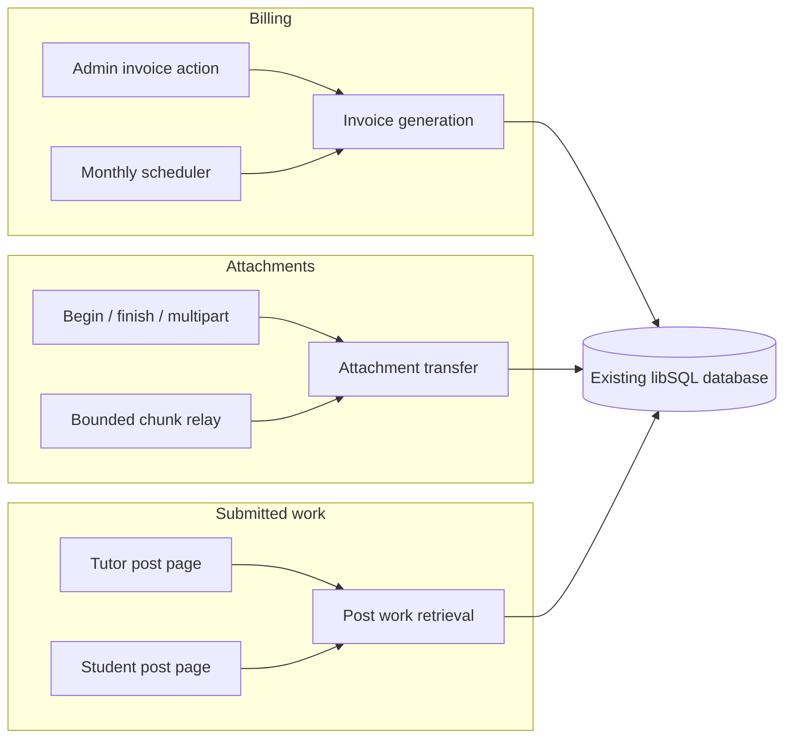

# Architecture implementation — 23 November 2026

All three candidates from the architecture review were selected for implementation. Baseline: `341aa9a`. This change deepens the existing invoice, attachment and submitted-work responsibilities; it does not introduce a new database or storage provider, migrate data, or merge tutor/student presentation.

## 1. Invoice generation

**Module/interface:** `lib/invoice-generation.ts` exposes `generateRangeDrafts(studentId, startDate, endDate, notes?)` and `generateMonthlyDrafts(month)`. Callers no longer need a transaction, selected lesson rows or month partitions. `lib/monthly-invoices.ts` retains the Malaysia scheduler window and re-exports monthly generation for existing imports.

The implementation owns one eligibility rule, month grouping, rounded line amounts, header totals, documents, lesson claims and atomic monthly completion markers. A failed later-month insert rolls back earlier documents and claims in the same range. Manual generation still permits trial-only/free drafts; automatic generation skips zero totals. Deactivated students retain invoice-eligible history. Absent/canceled/unmarked lessons remain excluded, and rescheduled free trials remain free.

**Depth/locality/leverage:** Manual and automatic adapters cross the same seam without knowing transaction choreography. Deleting this module would reintroduce selection, grouping, arithmetic and claim ordering across both callers. There is one real persistence implementation, so no speculative repository adapter was added.

Eligible timestamps are normalized to UTC before Malaysia-month grouping. Tests explicitly change server timezone and cover legacy SQLite text and offset timestamps. Invalid manual student IDs cannot widen selection to all students.

## 2. Attachment transfer

**Module/interface:** `lib/attachment-transfer.ts` exposes current actor/session resolution and a request-scoped transfer with `begin`, `ticket` and `complete`. It owns account precedence, parent-link identity, same-origin checks, allowed Google upload targets, ticket/actor matching, expected terminal file identity, uploaded-file ownership and pending receipts. `lib/upload-authority.ts` retains the signed-ticket and receipt primitives.

The existing route adapters still implement multipart requests and resumable byte transfer. Chunk limits, range acknowledgement, cancellation and retry handling stay with the actual transport. There is no new multi-cloud storage interface. Recovery's existing admin-only receipt flow remains distinct.

**Depth/locality/leverage:** Begin, chunk and finish cross one authority seam; they no longer independently implement account/ticket/target/receipt rules. Deleting the module would spread that knowledge back across the adapters. Controlled-provider route tests continue to exercise the same interface used in production, rather than replacing lifecycle assertions with token-only tests.

Explicit parent/student views do not borrow an administrator cookie. Revoked parent links cannot start another chunk or finish a transfer. The pre-existing multipart rejection for a missing active student and resumable parent fallback remain unchanged; this refactor does not silently decide a different deactivation policy.

## 3. Submitted-work retrieval

**Module/interface:** `lib/submitted-work.ts` exposes `loadPostWork(studentId, postId)`. It validates identifiers and active post ownership before loading attachments or work, then returns the post, attachments, current submission, retained attempts and whether the post accepts work. Pages still establish the actual tutor/student session before calling it.

Current projection and attempt lineage are read in one statement without repeating the current rich-text body on each historical row, preventing a concurrent new attempt from mixing two different revisions into one view. Saved grading maxima are attached to the matching current attempt; recorded null maxima remain null, while legacy projections without a version retain their fallback. Material/announcement posts do not expose stale submission records; legacy quizzes still accept work.

**Depth/locality/leverage:** Tutor and student presentation adapters cross one retrieval seam without arranging projection/history SQL themselves. Deleting the module would duplicate ownership, lineage ordering and rubric-snapshot knowledge in both pages. Attempt types now belong to `lib/types.ts`, eliminating the pages' dependency on a UI-owned persistence type. Grading writes and role-specific controls stay at their existing locations.

Tests use actual temporary SQLite through this interface. Separate presentation tests stub the complete returned work model and verify authorization ordering, latest-only grading controls, history, file-only work and recorded grade display. Updating assignment points no longer changes the displayed maximum of the latest already graded attempt; the grading form still uses the current assignment rubric for a new grade.

## Verification

- `npm test`: 143 tests passed, including real SQLite races, rollback, active-owner scoping, lineage, null/legacy rubric behavior and upload lifecycle tests.
- `npm run build`: production compilation and TypeScript checking passed.
- Integration evidence is retained under `.audit/runs/2026-11-23-architecture/`: local HTTP concurrency, tutor/student grade snapshot checks and desktop/mobile route checks.
- Independent read-only reviews found no actionable problems in the new submitted-work interface, invoice transaction ownership or attachment completion/catch handling.

Browser/load checks use isolated synthetic records and controlled video/storage substitutes. They do not establish live Google Drive permissions, internet upload speed or production capacity. No real billing, uploads or fake business records were created in production.
